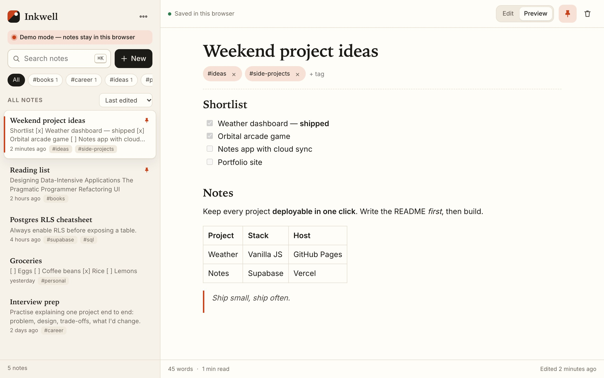

# Inkwell

**Markdown notes that autosave and sync across your devices.**

Inkwell is a keyboard-friendly notes app built with plain HTML, CSS and vanilla JavaScript (no framework, no build step), backed by **Supabase** for accounts and cloud storage. You can also try it without an account in Demo mode, where notes stay in your browser.

**Live demo:** https://inkwell-m-ahnaff.vercel.app



## Features

- **Accounts:** sign up and sign in with email + password or a magic link; password reset; stays signed in.
- **Cloud sync:** notes are stored in Postgres and protected by Row Level Security, so each user can only ever see their own notes.
- **Autosave:** live *Saving… / Saved / Offline — retrying* status. Unsaved edits survive a closed tab, a crash or going offline.
- **Markdown:** edit/preview toggle with GitHub-flavoured markdown (tables, task lists, code). Output is sanitized.
- **Organise:** pin notes, tag them, filter by tag, and search titles, content and tags.
- **Safety nets:** delete with undo, plus export to JSON or Markdown and import from JSON.
- **Keyboard first:** <kbd>Ctrl/⌘ K</kbd> search, <kbd>Alt N</kbd> new note, <kbd>Ctrl/⌘ E</kbd> edit/preview, <kbd>?</kbd> all shortcuts.
- **Responsive and accessible:** desktop sidebar layout, phone list → editor layout, light/dark themes, full keyboard and screen-reader support.
- **Demo mode:** try everything without an account. When you sign up later, the app offers to copy your demo notes into your account.

## Tech stack

| Layer | Choice |
|---|---|
| Frontend | HTML, CSS, vanilla JS (ES modules), no build step |
| Auth + database | [Supabase](https://supabase.com) (Postgres, Auth, Row Level Security) via `supabase-js` |
| Markdown | [marked](https://marked.js.org) + [DOMPurify](https://github.com/cure53/DOMPurify) |
| Hosting | [Vercel](https://vercel.com) (static) |

## Quick start

```sh
git clone https://github.com/m-ahnaff/notes-app.git
cd notes-app
python3 -m http.server 8743
# open http://localhost:8743
```

That's all you need to run it locally. To use **your own** Supabase project instead of the hosted one, follow [docs/SUPABASE_SETUP.md](docs/SUPABASE_SETUP.md). If you clear the two values in `js/config.js`, the app runs in Demo mode only.

## Documentation

| Guide | What it covers |
|---|---|
| [docs/ARCHITECTURE.md](docs/ARCHITECTURE.md) | Project structure, the storage layer, how autosave and sync work, conflict handling |
| [docs/SUPABASE_SETUP.md](docs/SUPABASE_SETUP.md) | Creating the database, security rules, keys and login URLs |
| [docs/DEPLOYMENT.md](docs/DEPLOYMENT.md) | Deploying to Vercel (CLI or GitHub) and to other static hosts |
| [SECURITY.md](SECURITY.md) | Why the public key is safe, how data is protected, reporting issues |

## Project structure

```
index.html              App shell and Content-Security-Policy
css/styles.css          Design tokens, light/dark themes, layout
js/app.js               Boot, demo ↔ cloud mode, list and editor UI, shortcuts
js/auth.js              Supabase client, sign-in screens, email-link redirects
js/sync.js              Autosave engine (debounced, serialized, retrying)
js/store/               Storage interface + localStore (demo) + supabaseStore (cloud)
js/markdown.js          Markdown rendering and sanitizing
js/io.js                Export / import
supabase/schema.sql     Database table, trigger and security policies
docs/                   Guides (see above)
```

## License

[MIT](LICENSE) © m-ahnaff
